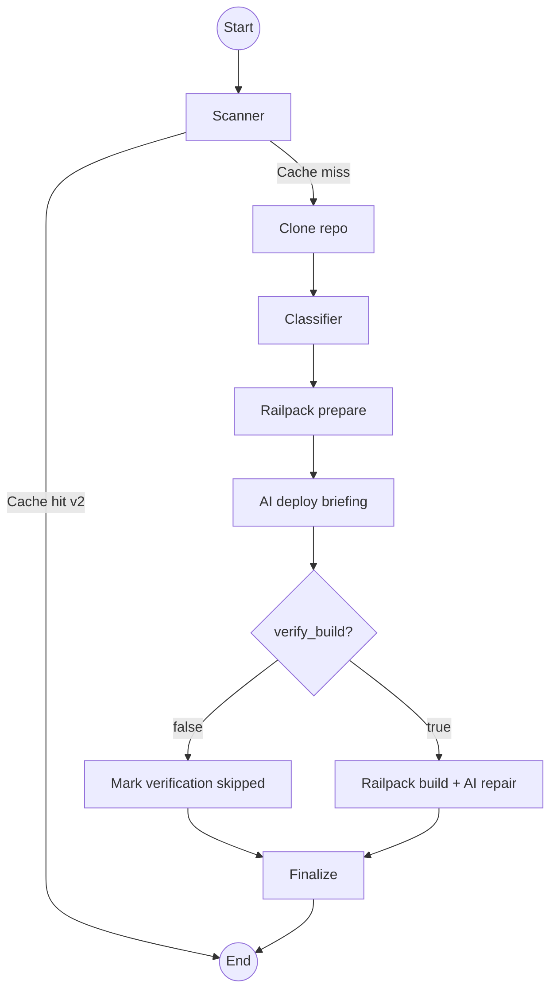

# SD-Artifacts Repo Analyzer (v2)

SD-Artifacts is a FastAPI service that answers: **given a GitHub `repo_url` and `package_path`, how do we deploy it?**

It uses **Railpack** to generate build plans, **LangGraph** to orchestrate the pipeline, and **Bedrock LLMs** for deploy briefings and optional build repair — not for writing Dockerfiles or compose files.

## What It Does

- Scans public or private GitHub repositories (scoped to `package_path`).
- Classifies deploy shape: static, Vite/static build, server app, or multi-package workspace.
- Runs `railpack prepare`; build verification is opt-in with `verify_build: true`.
- Returns `railpack_plan` JSON + human-readable `deploy_briefing` for [smart-deploy.xyz](https://smart-deploy.xyz), with an honest build-verification status.
- Caches results in Supabase (`repo_url + commit_sha + package_path`, schema v2).
- Full audit trail: `pipeline_trace`, `repair_history`, `build_status`.

## Pipeline



## API (v2 — hard cut)

### POST /analyze

```json
{
  "repo_url": "https://github.com/user/repo",
  "package_path": "apps/web",
  "github_token": "optional",
  "max_files": 50,
  "commit_sha": "optional-cache-lookup",
  "refresh": false,
  "verify_build": false
}
```

Set `"refresh": true` to bypass Supabase cache and re-run the full pipeline (scanner cache + `commit_sha` lookup). Refreshed results replace the existing cache row.

Analysis defaults to **preparing a plan without executing a build**. The response
includes the plan and briefing, `build_status: "skipped"`, and
`build_verification: {"requested": false, "status": "skipped", ...}`. No local or
remote build is started. A previously verified cache result may still be reused
with its actual build status.

Set `"verify_build": true` to run build verification. These requests ignore
cache entries whose verification was not requested, and replace them with the new
result. Verification can outlast a short client's deadline; callers requiring a
terminal build outcome must allow the required time. The stream still has its
configured total deadline. This option does not add asynchronous build polling.

Static deploy units return `port: null`: building static assets does not establish
a production listening port. The networking section describes static hosting and
any serving command actually present in the plan. Server-unit classifier ports
are labelled as default suggestions that need runtime confirmation. Cache entries
with the older guessed static ports are regenerated and replaced automatically.

### POST /analyze/stream

Accepts the same authenticated request and returns SSE `progress` events followed by
one terminal `complete` (schema-v2 analysis) or `error` event. Cache hits return the
cached result without simulated pipeline stages or delays.

The entire stream has a default **110-second** deadline, including cache reads and
result persistence. Configure `SD_ANALYZE_STREAM_TIMEOUT_SECONDS` for consumers with
longer deadlines. A client or proxy must allow more time than this setting; a
120-second client deadline leaves only 10 seconds for connection and transport
overhead. With `verify_build: true`, cold analysis can exceed 120 seconds: GitHub
scanning/cloning, a briefing with a 90-second budget, and build verification with
a separate 60-second budget run sequentially. Default analysis omits the build
stage. Individual stage limits do not bound total analysis time.

On deadline expiry, the terminal event has `detail.code: "analysis_timeout"`, a
`request_id`, elapsed time, `last_completed_node`, and `retryable: false`. This is
an analysis timeout and does not establish that the build failed. The
`X-Request-ID` response header correlates with server timing logs. See
[timeout and cancellation semantics](docs/retry-timeout-strategy.md#stream-deadline-and-cancellation)
before retrying or reconnecting.

### Response (excerpt)

```json
{
  "schema_version": 2,
  "build_status": "skipped",
  "build_verification": { "requested": false, "status": "skipped" },
  "deploy_shape": "static_build",
  "deploy_units": [{
    "name": "web",
    "root": "apps/web",
    "type": "static_build",
    "port": 3000,
    "artifacts": { "railpack_plan": {}, "railpack_json": null }
  }],
  "deploy_briefing": "# How this deploy works\n...",
  "repair_history": [],
  "railpack_version": "0.22.2"
}
```

## Requirements

- Python 3.10+
- GitHub token (private repos / rate limits)
- Amazon Bedrock credentials (optional; enables AI briefings and build repair)
- Supabase (cache + audit log)
- **Railpack CLI** + Docker/BuildKit on the host for local build verification, unless remote CodeBuild builds are enabled
- `SD_API_BEARER_TOKEN` for API auth

## Setup

```bash
python -m venv venv
source venv/bin/activate
pip install -r requirements.txt
# Install Railpack: https://railpack.com
```

Apply Supabase schema: `supabase_schema.sql` (fresh) or `migrations/v2_schema.sql` (upgrade).

Bedrock is optional. Missing/invalid credentials, denied model access, and invalid
region/model configuration quietly use a deterministic deployment briefing from
the Railpack plan. These setup failures do not add API errors or expose provider
exception details. AI repair is skipped for the rest of that request; a failed
build still reports its actual failure and build logs. Later requests can try
Bedrock again after configuration is corrected. Transient model failures retain
their existing retry and diagnostic behavior. Existing cached analyses keep their
stored payload until refreshed.

## Environment

```env
AWS_ACCESS_KEY_ID=...
AWS_SECRET_ACCESS_KEY=...
AWS_DEFAULT_REGION=...
BEDROCK_MODEL_ID=anthropic.claude-3-haiku-20240307-v1:0
SUPABASE_URL=...
SUPABASE_SERVICE_ROLE_KEY=...
SD_API_BEARER_TOKEN=...
SD_WORKFLOW_VERSION=sd-artifacts@local
SD_RAILPACK_VERIFY_TIMEOUT_SECONDS=60
```

## smart-deploy integration

smart-deploy consumes `deploy_units[].artifacts.railpack_plan` and builds with:

```bash
docker buildx build \
  --build-arg BUILDKIT_SYNTAX="ghcr.io/railwayapp/railpack-frontend" \
  -f railpack-plan.json \
  /path/to/cloned/repo
```

Pin `railpack_version` from the API response to the matching frontend image tag.

## MCP Server

```bash
python mcp_server.py
```

Cache resources (v2):
- `analysis-cache://{repo_url_b64}/{commit_sha}`
- `analysis-cache://{repo_url_b64}/{commit_sha}/{package_path_b64}`
